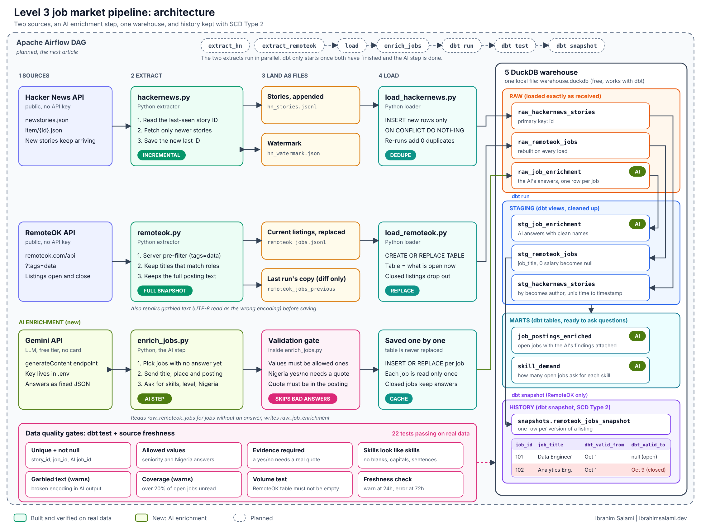

# Level 3: Job Market Pipeline

A small data pipeline that tracks the job market I'm trying to break into.

It pulls from two public sources, loads them into a local warehouse, **reads each job posting with an AI model**, cleans everything with dbt, and keeps a **history** of remote data jobs so I can see when a listing opened and when it closed.

This is Level 3 of my learn-in-public data engineering series. Level 1 was a GitHub ETL, Level 2 was an RSS pipeline on AWS. This one repeats the basics and adds new skills on purpose:

- incremental loading (do not re-fetch what you already have)
- SCD Type 2 (keep history when data changes or disappears)
- an AI enrichment step, with its answers checked by code and by dbt tests
- deliberate data quality tests
- a new warehouse (DuckDB) and a new orchestrator (Airflow, in progress)



## The idea in 30 seconds

Think of it like two mail carriers, a reader and one filing cabinet.

1. **Hacker News carrier.** New stories show up all day. The carrier remembers the last story ID they saw, so next time they only pick up newer ones. That is *incremental loading*.
2. **RemoteOK carrier.** This source only tells you what is open *right now*. It never says "this job closed". So the carrier brings the whole current list every time.
3. **The reader (AI).** Every job posting is a wall of text. The reader fills in a small form for each one: skills, seniority, years of experience, and whether someone in Nigeria can apply. For the Nigeria answer it must quote the exact words it based the answer on, and my code checks the quote is really in the posting.
4. **The filing cabinet (DuckDB).** Everything lands in a raw drawer first. dbt then cleans it into a tidy drawer and builds two summary tables on top.
5. **The history book.** Each time dbt runs a snapshot, it compares today's RemoteOK list to what it saw before. If a job vanished, it writes down *when*. That is *SCD Type 2*.

## Status

| Piece | State |
| --- | --- |
| Hacker News extractor (watermark) and loader | Built, verified on real data |
| RemoteOK extractor and loader | Built, verified on real data |
| AI enrichment (`enrich_jobs.py`, Gemini free tier) | Built, verified on real data |
| dbt staging models | Built, verified |
| dbt marts (`job_postings_enriched`, `skill_demand`) | Built, verified |
| dbt tests (22) and source freshness | Built, passing |
| dbt snapshot (SCD Type 2) | Built, verified |
| Airflow DAG | **Planned, next article** |

## Two sources, two loading patterns

| | Hacker News | RemoteOK |
| --- | --- | --- |
| What it gives me | A stream of new stories | The jobs open right now |
| Extract pattern | Incremental, using a watermark | Full snapshot every run |
| Landing file | `hn_stories.jsonl` (appended) | `remoteok_jobs.jsonl` (replaced) |
| Load pattern | Insert new rows, skip duplicates | Replace the whole table |
| Where history comes from | Rows are only ever added | dbt snapshot (SCD Type 2) |

The RemoteOK loader replaces the table on purpose. The raw table always means "what is open now", and the snapshot is what remembers the past.

Both extractors retry on network errors. If Hacker News fetches fail, the watermark does not move, so nothing is skipped. If RemoteOK fails, the previous snapshot is kept instead of being wiped.

The RemoteOK extractor also repairs garbled text (UTF-8 that was read with the wrong encoding, like `Österreich` for `Österreich`) before saving, and prints how many fields it repaired.

## The AI step

`extractors/enrich_jobs.py` reads each RemoteOK posting once and asks a Gemini Flash-Lite model for a fixed shape of answer:

| Field | What it holds |
| --- | --- |
| `skills` | Tools and technologies the posting names (short, lowercase) |
| `seniority` | intern, junior, mid, senior, lead, or unknown |
| `years_experience_min` | Minimum years asked for, or empty |
| `open_to_nigeria` | yes, no, or unclear |
| `nigeria_evidence` | The exact quote behind a yes or no |
| `summary` | One plain sentence about the role |

Design choices:

- **Fixed shape.** The API is told the exact JSON schema and the allowed values, with temperature 0.
- **Send every signal.** The model sees the title, company, location field and posting text. An early version left out the location and gave worse answers.
- **Evidence, checked by code.** A yes or no about Nigeria needs a quote, and the quote must appear in the text the model was shown. A paraphrase gets skipped, on purpose.
- **Validate before saving.** Wrong types, values outside the allowed list, or bad evidence are skipped and reported, never stored.
- **Read each job once.** Answers go into `raw_job_enrichment`, a table that is never replaced. Each run only picks up jobs with no answer yet, which protects the free quota. It also keeps answers for jobs that have since closed.
- **Untrusted input.** The posting is treated as text written by a stranger, and the prompt tells the model never to follow instructions inside it.
- **Quota-friendly.** A pause between requests, retries with growing waits, and a clean stop when the key or model name is wrong.

Flags: `--limit N` (default 20), `--redo` (clear answers and read again, for example after changing the prompt), `--list-models` (see which model names your key can use).

## How SCD Type 2 works here

`remoteok_jobs_snapshot` keeps one row per version of a listing. The important setting is `hard_deletes='invalidate'`, which tells dbt: if a `job_id` is missing from today's data, close its row instead of ignoring it.

| job_id | job_title | dbt_valid_from | dbt_valid_to |
| --- | --- | --- | --- |
| 101 | Data Engineer | Oct 1 | null (still open) |
| 102 | Analytics Engineer | Oct 1 | Oct 9 (closed) |

Listings that closed:

```sql
select job_id, job_title, company, dbt_valid_from, dbt_valid_to
from snapshots.remoteok_jobs_snapshot
where dbt_valid_to is not null;
```

The snapshot watches these columns for changes: `job_title`, `company`, `tags`, `location`, `salary_min`, `salary_max`, `url`.

## The marts

| Table | What it is |
| --- | --- |
| `job_postings_enriched` | One row per job open right now, with the AI's findings attached. A job the AI has not read yet still appears (`is_enriched = false`), so gaps are visible instead of silently missing. |
| `skill_demand` | How many open jobs ask for each skill: `skill`, `open_jobs`, `pct_of_open_jobs`, `open_to_nigeria_jobs`. |

```sql
select skill, open_jobs, pct_of_open_jobs
from skill_demand
order by open_jobs desc
limit 10;
```

On the 18 postings I ran it on, SQL led (10 jobs), followed by Power BI, Python, Excel and Tableau. Only one job was open to Nigeria. Eighteen postings is a small sample, so treat it as a demo of the pipeline, not a claim about the whole market.

## Data quality

| Check | What it protects against | If it triggers |
| --- | --- | --- |
| `unique` and `not_null` on `story_id`, `job_id` and the AI table's `job_id` | Duplicate or missing IDs | Fails |
| `not_null` on `posted_at`, `job_title` and `summary` | Broken dates, titles or empty AI summaries | Fails |
| Allowed values on `seniority` and `open_to_nigeria` | The model inventing a category | Fails |
| `assert_nigeria_answers_have_evidence` | A yes or no with no quote behind it | Fails |
| `assert_skills_look_like_skills` | Blank, capitalised or sentence-like skills | Fails |
| `assert_enrichment_has_no_garbled_text` | Broken encoding leaking into the AI output | Warns |
| `assert_most_open_jobs_are_enriched` | The AI step silently stopped (expired key, quota), leaving over 20 percent of open jobs unread | Warns |
| `assert_remoteok_jobs_not_empty` | The API breaks and the table quietly becomes empty | Fails |
| Source freshness (warn at 24h, error at 72h) | A pipeline that stopped running without anyone noticing | Warns, then errors |

Wrong data stops the line (fail). Suspicious data asks for a human (warn).

I left out a `relationships` test between the AI table and the jobs table on purpose. The AI table keeps answers for closed jobs, so that test would fail for a good reason, and a test that always cries wolf teaches you to ignore tests.

## Tech stack

| Layer | Tool |
| --- | --- |
| Extract and load | Python (standard library for HTTP) |
| AI enrichment | Google Gemini Flash-Lite via the REST API (free tier, no card) |
| Warehouse | DuckDB (one local file, free) |
| Transform, test, snapshot | dbt with the `dbt-duckdb` adapter |
| Orchestration | Apache Airflow (planned) |

## Project structure

```
de-level3-pipeline/
├── .env.example                  # copy to .env and add your Gemini key
├── .gitignore                    # keeps .env, data and build output out of git
├── requirements.txt
├── dags/                         # Airflow DAG goes here (planned)
├── docs/
│   ├── architecture.svg
│   └── architecture.png
├── extractors/
│   ├── hackernews.py             # incremental extract, watermark file
│   ├── load_hackernews.py        # dedupe on id, insert new rows only
│   ├── remoteok.py               # tags=data pre-filter, keeps description, repairs text
│   ├── load_remoteok.py          # replace the raw table each run
│   ├── enrich_jobs.py            # the AI step: read each posting once, validate, save
│   ├── inspect_warehouse.py      # look inside the warehouse (before/after dbt, check one job)
│   ├── simulate_closure.py       # demo helper: pretend a job was filled
│   └── data/                     # generated files and warehouse.duckdb (git-ignored)
└── dbt/
    ├── dbt_project.yml
    ├── profiles.yml              # points at ../extractors/data/warehouse.duckdb
    ├── models/
    │   ├── staging/
    │   │   ├── sources.yml       # raw tables + freshness rules
    │   │   ├── schema.yml        # not_null / unique / allowed-values tests
    │   │   ├── stg_hackernews_stories.sql
    │   │   ├── stg_remoteok_jobs.sql
    │   │   └── stg_job_enrichment.sql
    │   └── marts/
    │       ├── schema.yml
    │       ├── job_postings_enriched.sql
    │       └── skill_demand.sql
    ├── snapshots/
    │   └── remoteok_jobs_snapshot.sql
    └── tests/
        ├── assert_remoteok_jobs_not_empty.sql
        ├── assert_nigeria_answers_have_evidence.sql
        ├── assert_skills_look_like_skills.sql
        ├── assert_enrichment_has_no_garbled_text.sql
        └── assert_most_open_jobs_are_enriched.sql
```

## Run it yourself

I build this on Windows with PowerShell, so the commands use the `py` launcher. On macOS or Linux, use `python3` instead of `py`.

**1. Set up**

```powershell
git clone <this-repo-url>
cd de-level3-pipeline
py -m venv .venv
.venv\Scripts\Activate.ps1
py -m pip install -r requirements.txt
```

**2. Add your Gemini key**

Get a free key from Google AI Studio (no card needed). Then copy `.env.example` to a new file named `.env` in the project root and paste the key in:

```
GEMINI_API_KEY=your-key-here
GEMINI_MODEL=gemini-3.5-flash-lite
```

`.env` is git-ignored, so the key never reaches GitHub. Model names change often. If yours is rejected, run `py enrich_jobs.py --list-models` from the `extractors` folder and use a name it prints.

**3. Extract and load** (run from the `extractors` folder)

```powershell
cd extractors
py hackernews.py
py load_hackernews.py
py remoteok.py
py load_remoteok.py
```

Run `hackernews.py` twice. The second run only fetches stories that appeared in between.

**4. Run the AI step** (still in `extractors`)

```powershell
py enrich_jobs.py --limit 20
```

Check one answer against the real posting:

```powershell
py inspect_warehouse.py check arabian
```

**5. Transform, snapshot, test** (run from the `dbt` folder)

```powershell
cd ..\dbt
py -m dbt.cli.main run --profiles-dir .
py -m dbt.cli.main snapshot --profiles-dir .
py -m dbt.cli.main test --profiles-dir .
py -m dbt.cli.main source freshness --profiles-dir .
```

I call dbt as `py -m dbt.cli.main` because on my machine pip put `dbt.exe` in a folder that is not on PATH. If `dbt` works for you, use it directly.

If the tests warn that over 20 percent of open jobs are unread, that is the coverage test doing its job. Run `enrich_jobs.py` with a bigger `--limit`.

**6. Look at the results** (from the `extractors` folder)

```powershell
py inspect_warehouse.py after
py inspect_warehouse.py "select skill, open_jobs, pct_of_open_jobs from skill_demand order by open_jobs desc limit 10"
```

**7. Watch a listing close**

Run `dbt snapshot` once, then pretend a job was filled (from the `extractors` folder):

```powershell
py simulate_closure.py
```

Run `dbt snapshot` again, then check the result from the `extractors` folder. That job's `dbt_valid_to` is now filled in, and every other listing is still open.

To compare the data before and after dbt, run `py inspect_warehouse.py before` and `py inspect_warehouse.py after` around your `dbt run`.

## Things that went wrong (and what I learned)

- **A source that lied.** Remotive's public API ignored every query parameter (`search`, `category`, `limit`) and always returned the same 15 generic jobs. I proved it by checking the API's own `job-count` field before blaming my code, then switched to RemoteOK.
- **A reserved word.** Hacker News gives each story a `by` field. `by` is reserved in SQL, so it has to be written as `"by"` in DuckDB. dbt renames it to `author`.
- **Server filter plus client filter.** RemoteOK's plain feed had zero matching titles on one run. Pre-filtering with `tags=data` on the server gave a bigger pool (about 100), and a strict title match on my side kept the real ones.
- **Cost walls are real.** I planned on BigQuery, but billing in Nigeria required a $30 prepayment. DuckDB keeps the same dbt workflow for free.
- **The model could not see what I could.** My first AI run guessed about Nigeria because I had not sent the location field. Sending every signal, and making the model quote its evidence, fixed it.
- **A skipped job that was not the model's fault.** The strict evidence check skipped one job because its stored location was already garbled by a text encoding mix-up. The fix belonged at the front door (`repair_text` in the extractor), not in the AI step.

## Roadmap

- [ ] Airflow DAG: two extracts in parallel, then load, `enrich_jobs`, `dbt run`, `dbt snapshot`, `dbt test`
- [ ] Run it on a schedule so the history builds up on its own
- [ ] Keep a record of which prompt produced which AI answers
- [x] A marts layer, including which skills appear most in open roles
- [x] AI enrichment with validation and dbt tests

## Author

Ibrahim Salami, systems analyst moving into data engineering.
[ibrahimsalami.dev](https://ibrahimsalami.dev) | [YouTube](https://youtube.com/@ibbysalam)
